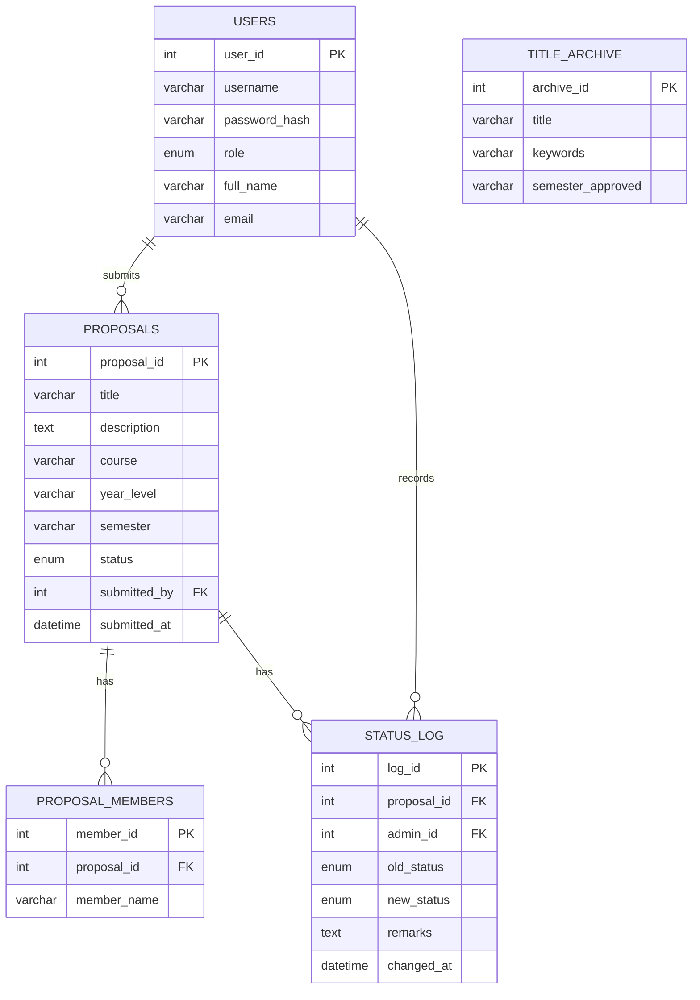

# Database schema — IT Capstone Proposal Management and Tracking System

MySQL. Two roles only (`Student`, `Admin`) — there is no adviser/staff
table.

## ERD



## CREATE TABLE statements (ready to paste)

```sql
CREATE DATABASE IF NOT EXISTS it_capstone_proposal_system
  CHARACTER SET utf8mb4 COLLATE utf8mb4_unicode_ci;

USE it_capstone_proposal_system;

CREATE TABLE tbl_users (
  user_id       INT AUTO_INCREMENT PRIMARY KEY,
  username      VARCHAR(50)  NOT NULL UNIQUE,
  password_hash VARCHAR(255) NOT NULL,
  role          ENUM('Student', 'Admin') NOT NULL,
  full_name     VARCHAR(100) NOT NULL,
  email         VARCHAR(100) NOT NULL UNIQUE,
  created_at    DATETIME NOT NULL DEFAULT CURRENT_TIMESTAMP
) ENGINE=InnoDB;

CREATE TABLE tbl_proposals (
  proposal_id   INT AUTO_INCREMENT PRIMARY KEY,
  title         VARCHAR(255) NOT NULL,
  description   TEXT NOT NULL,
  course        VARCHAR(50) NOT NULL,
  year_level    VARCHAR(20) NOT NULL,
  semester      VARCHAR(20) NOT NULL,
  status        ENUM('Pending', 'Approved', 'Rejected', 'ForRevision')
                  NOT NULL DEFAULT 'Pending',
  submitted_by  INT NOT NULL,
  submitted_at  DATETIME NOT NULL DEFAULT CURRENT_TIMESTAMP,
  updated_at    DATETIME NULL ON UPDATE CURRENT_TIMESTAMP,
  CONSTRAINT fk_proposals_user
    FOREIGN KEY (submitted_by) REFERENCES tbl_users(user_id)
) ENGINE=InnoDB;

CREATE TABLE tbl_proposal_members (
  member_id    INT AUTO_INCREMENT PRIMARY KEY,
  proposal_id  INT NOT NULL,
  member_name  VARCHAR(100) NOT NULL,
  CONSTRAINT fk_members_proposal
    FOREIGN KEY (proposal_id) REFERENCES tbl_proposals(proposal_id)
    ON DELETE CASCADE
) ENGINE=InnoDB;

CREATE TABLE tbl_status_log (
  log_id       INT AUTO_INCREMENT PRIMARY KEY,
  proposal_id  INT NOT NULL,
  admin_id     INT NOT NULL,
  old_status   ENUM('Pending', 'Approved', 'Rejected', 'ForRevision') NULL,
  new_status   ENUM('Pending', 'Approved', 'Rejected', 'ForRevision') NOT NULL,
  remarks      TEXT NULL,
  changed_at   DATETIME NOT NULL DEFAULT CURRENT_TIMESTAMP,
  CONSTRAINT fk_log_proposal
    FOREIGN KEY (proposal_id) REFERENCES tbl_proposals(proposal_id)
    ON DELETE CASCADE,
  CONSTRAINT fk_log_admin
    FOREIGN KEY (admin_id) REFERENCES tbl_users(user_id)
) ENGINE=InnoDB;

-- Snapshot activity events are intentionally independent of proposals so
-- delete events remain available after a proposal is removed.
CREATE TABLE IF NOT EXISTS tbl_proposal_activity (
  activity_id   INT AUTO_INCREMENT PRIMARY KEY,
  action_type   ENUM('Submitted', 'Deleted') NOT NULL,
  proposal_title VARCHAR(255) NOT NULL,
  actor_name    VARCHAR(100) NOT NULL,
  created_at    DATETIME NOT NULL DEFAULT CURRENT_TIMESTAMP
) ENGINE=InnoDB;

CREATE TABLE tbl_title_archive (
  archive_id        INT AUTO_INCREMENT PRIMARY KEY,
  title             VARCHAR(255) NOT NULL,
  keywords          VARCHAR(255) NOT NULL,
  semester_approved VARCHAR(20) NOT NULL
) ENGINE=InnoDB;
```

## Notes

- Existing databases must create `tbl_proposal_activity` before deploying the
  updated application. This snapshot table intentionally has no foreign key
  to proposals so Admin submission/deletion events remain visible after a
  proposal is removed.

- `tbl_status_log` doubles as the audit trail and the source for "remarks"
  shown to students — don't add a separate `remarks` column on
  `tbl_proposals` itself; always read the latest row from this table
  instead, so history isn't lost on every status change.
- `tbl_title_archive.keywords` stores the same normalized keyword set the
  `DuplicateChecker` computes at submission time, so archived titles from
  past semesters can be compared without re-tokenizing every lookup.
- Seed at least one `Admin` account directly via SQL (`INSERT INTO
  tbl_users ...`) before first run — there's no self-registration flow for
  Admins in the current scope.
