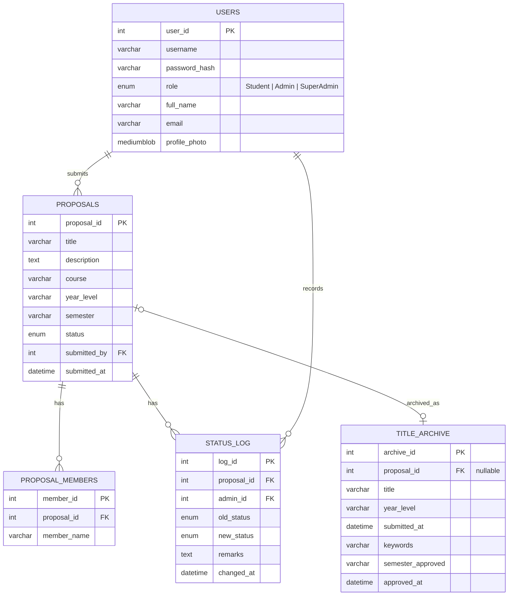

# Database schema — IT Capstone Proposal Management and Tracking System

MySQL. Roles are `Student`, `Admin`, and protected `SuperAdmin` — there is no
adviser/staff table. The `SuperAdmin` role is provisioned only by the setup
migration and cannot be assigned from the application.

## ERD



## CREATE TABLE statements (ready to paste)

```sql
CREATE DATABASE IF NOT EXISTS it_capstone_proposal_system
  CHARACTER SET utf8mb4 COLLATE utf8mb4_unicode_ci;

USE it_capstone_proposal_system;

CREATE TABLE tbl_users (
  user_id       INT AUTO_INCREMENT PRIMARY KEY,
  username      VARCHAR(50)  NOT NULL UNIQUE,
  password_hash VARCHAR(255) NOT NULL,
  role          ENUM('Student', 'Admin', 'SuperAdmin') NOT NULL,
  full_name     VARCHAR(100) NOT NULL,
  email         VARCHAR(100) NOT NULL UNIQUE,
  profile_photo MEDIUMBLOB NULL,
  created_at    DATETIME NOT NULL DEFAULT CURRENT_TIMESTAMP
) ENGINE=InnoDB;

CREATE TABLE tbl_proposals (
  proposal_id   INT AUTO_INCREMENT PRIMARY KEY,
  title         VARCHAR(255) NOT NULL,
  description   TEXT NOT NULL,
  course        VARCHAR(50) NOT NULL,
  year_level    VARCHAR(20) NOT NULL,
  semester      VARCHAR(20) NOT NULL,
  status        ENUM('Pending', 'Approved', 'Rejected', 'ForRevision')
                  NOT NULL DEFAULT 'Pending',
  submitted_by  INT NOT NULL,
  submitted_at  DATETIME NOT NULL DEFAULT CURRENT_TIMESTAMP,
  updated_at    DATETIME NULL ON UPDATE CURRENT_TIMESTAMP,
  CONSTRAINT fk_proposals_user
    FOREIGN KEY (submitted_by) REFERENCES tbl_users(user_id)
) ENGINE=InnoDB;

CREATE TABLE tbl_proposal_members (
  member_id    INT AUTO_INCREMENT PRIMARY KEY,
  proposal_id  INT NOT NULL,
  member_name  VARCHAR(100) NOT NULL,
  CONSTRAINT fk_members_proposal
    FOREIGN KEY (proposal_id) REFERENCES tbl_proposals(proposal_id)
    ON DELETE CASCADE
) ENGINE=InnoDB;

CREATE TABLE tbl_status_log (
  log_id       INT AUTO_INCREMENT PRIMARY KEY,
  proposal_id  INT NOT NULL,
  admin_id     INT NOT NULL,
  old_status   ENUM('Pending', 'Approved', 'Rejected', 'ForRevision') NULL,
  new_status   ENUM('Pending', 'Approved', 'Rejected', 'ForRevision') NOT NULL,
  remarks      TEXT NULL,
  changed_at   DATETIME NOT NULL DEFAULT CURRENT_TIMESTAMP,
  CONSTRAINT fk_log_proposal
    FOREIGN KEY (proposal_id) REFERENCES tbl_proposals(proposal_id)
    ON DELETE CASCADE,
  CONSTRAINT fk_log_admin
    FOREIGN KEY (admin_id) REFERENCES tbl_users(user_id)
) ENGINE=InnoDB;

-- Snapshot activity events are intentionally independent of proposals so
-- delete events remain available after a proposal is removed.
CREATE TABLE IF NOT EXISTS tbl_proposal_activity (
  activity_id   INT AUTO_INCREMENT PRIMARY KEY,
  action_type   ENUM('Submitted', 'Deleted') NOT NULL,
  proposal_title VARCHAR(255) NOT NULL,
  actor_name    VARCHAR(100) NOT NULL,
  created_at    DATETIME NOT NULL DEFAULT CURRENT_TIMESTAMP
) ENGINE=InnoDB;

CREATE TABLE tbl_title_archive (
  archive_id        INT AUTO_INCREMENT PRIMARY KEY,
  proposal_id       INT NULL UNIQUE,
  title             VARCHAR(255) NOT NULL,
  group_name        VARCHAR(100) NOT NULL,
  keywords          VARCHAR(255) NOT NULL,
  semester_approved VARCHAR(20) NOT NULL,
  year_level        VARCHAR(20) NOT NULL,
  submitted_at      DATETIME NOT NULL,
  approved_at       DATETIME NOT NULL,
  CONSTRAINT fk_title_archive_proposal
    FOREIGN KEY (proposal_id) REFERENCES tbl_proposals(proposal_id)
    ON DELETE SET NULL
) ENGINE=InnoDB;

-- Immutable snapshots of actions performed by administrators. Authentication
-- events belong in the separate Login Activity/Security Logs module.
CREATE TABLE IF NOT EXISTS tbl_admin_activity_log (
  activity_id  INT AUTO_INCREMENT PRIMARY KEY,
  actor_id     INT NULL,
  actor_name   VARCHAR(100) NOT NULL,
  action_type  VARCHAR(50) NOT NULL,
  entity_type  VARCHAR(50) NOT NULL,
  entity_id    INT NULL,
  entity_name  VARCHAR(255) NULL,
  description  VARCHAR(500) NOT NULL,
  metadata     TEXT NULL,
  created_at   DATETIME NOT NULL DEFAULT CURRENT_TIMESTAMP,
  CONSTRAINT fk_admin_activity_actor
    FOREIGN KEY (actor_id) REFERENCES tbl_users(user_id) ON DELETE SET NULL,
  INDEX ix_admin_activity_created_at (created_at),
  INDEX ix_admin_activity_action_type (action_type),
  INDEX ix_admin_activity_entity_type (entity_type)
) ENGINE=InnoDB;

CREATE TABLE IF NOT EXISTS tbl_login_activity (
  activity_id       INT AUTO_INCREMENT PRIMARY KEY,
  user_id           INT NOT NULL,
  username_snapshot VARCHAR(50) NOT NULL,
  event_type        ENUM('Login', 'Logout') NOT NULL,
  device_name       VARCHAR(255) NOT NULL,
  ip_address        VARCHAR(45) NOT NULL,
  created_at        DATETIME NOT NULL DEFAULT CURRENT_TIMESTAMP,
  CONSTRAINT fk_login_activity_user
    FOREIGN KEY (user_id) REFERENCES tbl_users(user_id) ON DELETE CASCADE,
  INDEX ix_login_activity_user_created (user_id, created_at)
) ENGINE=InnoDB;

CREATE TABLE IF NOT EXISTS tbl_active_session (
  session_id        CHAR(36) PRIMARY KEY,
  user_id           INT NOT NULL,
  username_snapshot VARCHAR(50) NOT NULL,
  device_name       VARCHAR(255) NOT NULL,
  ip_address        VARCHAR(45) NOT NULL,
  started_at        DATETIME NOT NULL DEFAULT CURRENT_TIMESTAMP,
  last_seen_at      DATETIME NOT NULL DEFAULT CURRENT_TIMESTAMP,
  revoked_at        DATETIME NULL,
  CONSTRAINT fk_active_session_user
    FOREIGN KEY (user_id) REFERENCES tbl_users(user_id) ON DELETE CASCADE,
  INDEX ix_active_session_user (user_id, revoked_at)
) ENGINE=InnoDB;
```

## Notes

- Existing databases must run `docs/migrations/002_add_user_profile_photo.sql`
  before deploying the profile module. New databases include the nullable
  `profile_photo` column in `tbl_users`.

- Before deploying the Super Admin role to an existing database, run
  `docs/migrations/001_add_super_admin_role.sql`. It promotes the lowest-ID
  existing Admin (the earliest-created account) unless a Super Admin already
  exists. Review the script's result and confirm exactly one protected account
  is present before deploying the application.
- The application does not allow Super Admin accounts to be created,
  demoted, deactivated, or deleted. Ordinary Admins cannot edit or reset the
  protected account; the Super Admin can edit its profile and reset its own
  password. Retain the setup migration as the recovery path.

- For an existing database, run this migration so archive snapshots retain
  their proposal link only while the proposal exists. It also stores year
  level and submission date independently, so those values survive deletion:

  ```sql
  ALTER TABLE tbl_title_archive
    ADD COLUMN year_level VARCHAR(20) NULL,
    ADD COLUMN submitted_at DATETIME NULL;

  UPDATE tbl_title_archive a
  INNER JOIN tbl_proposals p ON p.proposal_id = a.proposal_id
  SET a.year_level = p.year_level,
      a.submitted_at = p.submitted_at;

  ALTER TABLE tbl_title_archive
    DROP FOREIGN KEY fk_title_archive_proposal,
    ADD CONSTRAINT fk_title_archive_proposal
      FOREIGN KEY (proposal_id) REFERENCES tbl_proposals(proposal_id)
      ON DELETE SET NULL;
  ```

  If the existing archive table does not yet have `proposal_id`, run this
  instead of the foreign-key change above:

  ```sql
  ALTER TABLE tbl_title_archive
    ADD COLUMN proposal_id INT NULL,
    ADD UNIQUE KEY uq_title_archive_proposal_id (proposal_id),
    ADD CONSTRAINT fk_title_archive_proposal
      FOREIGN KEY (proposal_id) REFERENCES tbl_proposals(proposal_id)
      ON DELETE SET NULL;
  ```

  Archive rows already removed by an earlier cascade cannot be reconstructed
  from the archive table.

- Existing databases should add the archive metadata columns before deploying
  the updated application. Nullable columns allow current archive rows to be
  backfilled before making them required:

  ```sql
  ALTER TABLE tbl_title_archive
    ADD COLUMN group_name VARCHAR(100) NULL AFTER title,
    ADD COLUMN approved_at DATETIME NULL AFTER semester_approved;
  ```

- Existing databases must create `tbl_proposal_activity` before deploying the
  updated application. This snapshot table intentionally has no foreign key
  to proposals so Admin submission/deletion events remain visible after a
  proposal is removed.

- `tbl_status_log` doubles as the audit trail and the source for "remarks"
  shown to students — don't add a separate `remarks` column on
  `tbl_proposals` itself; always read the latest row from this table
  instead, so history isn't lost on every status change.
- `tbl_title_archive.keywords` stores the same normalized keyword set the
  `DuplicateChecker` computes at submission time, so archived titles from
  past semesters can be compared without re-tokenizing every lookup.
- An archive entry is created the first time a proposal is approved and kept
  if its status later changes or its proposal is deleted. `approved_at` is
  the first approval date; later approval cycles are recorded in
  `tbl_status_log` while the proposal exists and do not reset the archive
  date. Proposal deletion currently removes its status-log rows.
- Seed at least one `Admin` account directly via SQL (`INSERT INTO
  tbl_users ...`) before first run — there's no self-registration flow for
  Admins in the current scope.
